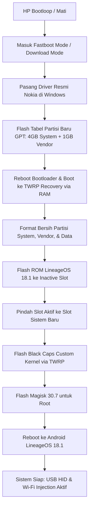

# Panduan Flashing Nokia 6.1 Plus (DRG / Dragon)
## Custom ROM LineageOS 18.1 + Black Caps Custom Kernel (USB HID & Packet Injection) + Magisk Root

Repositori ini berisi panduan teknis lengkap, file tools, dan prosedur langkah-demi-langkah untuk:
1. Memperbaiki ponsel Nokia yang mengalami **bootloop** akibat instalasi Kali NetHunter.
2. Memasang driver resmi Nokia Fastboot di **Windows 11** tanpa kendala signature.
3. Melakukan **repartisi tabel eMMC (GPT)** untuk mengatasi limit partisi bawaan 2.5GB (*Error 28*).
4. Memasang **LineageOS 18.1 (Android 11)** dengan skema partisi **A/B Slot**.
5. Memasang **Black Caps Custom Kernel** untuk mengaktifkan **USB Gadget HID (BadUSB)** dan dukungan driver dongle Wi-Fi eksternal (**Packet Injection / Monitor Mode**).
6. Memasang **Magisk 30.7** untuk hak akses penuh **Root (`su`)**.

---

## 📱 Spesifikasi Perangkat Target

| Parameter | Spesifikasi |
| :--- | :--- |
| **Model** | Nokia 6.1 Plus / Nokia X6 (TA-1099, TA-1103, TA-1116) |
| **Codename Internal** | `DRG` / `DRG_sprout` / `Dragon` |
| **Platform Chipset** | Qualcomm Snapdragon 636 (SDM636 / FIH SDM660 Platform) |
| **Skema Partisi** | A/B Seamless Partition (`_a` dan `_b`) |
| **Penyimpanan Internal** | 64 GB eMMC 5.1 |
| **Status Bootloader** | Unlocked & Critical Unlocked |

---

## 🛠️ Persiapan Alat & File Pendukung

Semua file pendukung utama telah tersedia di dalam repositori ini:

```text
nokia/
├── usb_driver/                               # Google & Universal ADB Driver
├── repartition_tool/                         # Nokia Repartition Tool & GPT Binaries
│   └── bin/
│       ├── FIH_SDM660_AVB1_gpt_both0_4s_1v.bin # Tabel GPT 4GB System + 1GB Vendor
│       └── twrp-3.4.0-0-DRG_sprout-11.0.img   # TWRP Recovery untuk Android 11
├── twrp.img                                  # Official TWRP 3.7.0 DRG_sprout
├── lineage-18.1-Dragon.zip                   # ROM LineageOS 18.1 (Android 11)
├── black_caps_11.0.zip                       # Custom Kernel Black Caps (AnyKernel3)
├── Magisk.zip                                # Magisk Installer untuk Root
├── test_hid.sh                               # Script pengujian kirim tombol via HID
└── fix_driver.ps1                            # Script helper perbaikan registry USB
```

---

## ⚡ Alur Kerja Flashing (Workflow)



---

## 📖 Prosedur Langkah-demi-Langkah

### Langkah 1: Masuk ke Mode Fastboot (Download Mode)
1. Matikan ponsel (atau saat bootloop restart berulang):
   - Tekan dan tahan tombol **Volume Bawah + Power** selama 8–10 detik sampai ponsel bergetar dan muncul logo Nokia dengan tulisan teks **"Download mode"** di pojok kiri atas layar.
2. Colokkan kabel USB ke laptop.

---

### Langkah 2: Setup Driver Nokia di Windows 11
Windows 11 sering kali menandai Nokia Fastboot sebagai `Android (Error: CM_PROB_FAILED_INSTALL)`.
Untuk mengatasinya:
1. Jalankan installer driver resmi Nokia yang sudah terunduh:
   ```cmd
   Phone_Nokia_USB_Driver_v1.4.0.exe /VERYSILENT /NORESTART
   ```
2. Pastikan koneksi terdeteksi via perintah:
   ```bash
   fastboot devices
   ```
   *(Harus menampilkan serial perangkat Anda, contoh: `DRGGAM2853102118    fastboot`)*.

---

### Langkah 3: Mengatasi Limit Partisi (Error 28) via GPT Repartition
Partisi bawaan Nokia 6.1 Plus hanya mengalokasikan 2.5GB untuk sistem, sedangkan Custom ROM modern membutuhkan ruang hingga 3.8GB. Jika tidak diubah, proses instalasi akan gagal dengan pesan:
`Error applying update: 28 (kDownloadOperationExecutionError)`.

Untuk memperbesar sistem menjadi **4.0 GB** dan vendor menjadi **1.0 GB**:
```bash
fastboot flash partition repartition_tool\bin\FIH_SDM660_AVB1_gpt_both0_4s_1v.bin
fastboot reboot-bootloader
```
*Verifikasi ukuran partisi baru:*
```bash
fastboot getvar partition-size:system_a
# Output: 0x100000000 (tepat 4.0 GB)
```

---

### Langkah 4: Boot TWRP Recovery & Format Filesystem
Boot ke TWRP sementara di memori RAM tanpa menimpa recovery internal:
```bash
fastboot boot repartition_tool\bin\twrp-3.4.0-0-DRG_sprout-11.0-20200909.img
```
Setelah masuk ke tampilan TWRP di layar HP, format seluruh partisi dengan filesystem EXT4 bersih melalui ADB:
```bash
adb shell "mke2fs -t ext4 /dev/block/bootdevice/by-name/system_a"
adb shell "mke2fs -t ext4 /dev/block/bootdevice/by-name/system_b"
adb shell "mke2fs -t ext4 /dev/block/bootdevice/by-name/vendor_a"
adb shell "mke2fs -t ext4 /dev/block/bootdevice/by-name/vendor_b"
adb shell "mke2fs -t ext4 /dev/block/bootdevice/by-name/userdata"
```

---

### Langkah 5: Flashing LineageOS 18.1 (Android 11)
1. Kirim file ROM ke memori internal ponsel:
   ```bash
   adb push lineage-18.1-Dragon.zip /data/lineage-18.1.zip
   ```
2. Jalankan instalasi A/B OTA via TWRP CLI:
   ```bash
   adb shell "/sbin/twrp install /data/lineage-18.1.zip"
   ```
   *(Tunggu hingga muncul konfirmasi `Done processing script file`)*.

---

### Langkah 6: Pindah Slot Aktif
Updater A/B secara otomatis memasang sistem ke slot yang sedang tidak aktif (Slot B). Alihkan slot aktif ke Slot B:
```bash
adb reboot bootloader
fastboot --set-active=b
```

---

### Langkah 7: Pasang Black Caps Custom Kernel (USB HID & Wi-Fi Injection)
1. Boot kembali ke TWRP:
   ```bash
   fastboot boot repartition_tool\bin\twrp-3.4.0-0-DRG_sprout-11.0-20200909.img
   ```
2. Kirim dan flash kernel AnyKernel3:
   ```bash
   adb push black_caps_11.0.zip /data/kernel.zip
   adb shell "/sbin/twrp install /data/kernel.zip"
   ```

---

### Langkah 8: Pasang Magisk (Root Superuser)
1. Kirim dan flash Magisk untuk mengaktifkan binary `su`:
   ```bash
   adb push Magisk.zip /data/magisk.zip
   adb shell "/sbin/twrp install /data/magisk.zip"
   ```
2. Bersihkan file instalasi dan reboot ke sistem:
   ```bash
   adb shell "rm -f /data/*.zip"
   adb reboot
   ```

---

## 🎯 Verifikasi & Penggunaan Fitur

### 1. Memeriksa Versi Kernel
- Di HP, buka **Settings** -> **About phone** -> **Kernel version**.
- Harus tertera: **`Black_Caps-Edition` by RaghuVarma**.

### 2. Mengaktifkan Root (`su`) di Terminal
1. Buka **Settings** -> **System** -> **Developer options** -> aktifkan **Local terminal**.
2. Buka aplikasi **Terminal** di HP, ketik `su` lalu tekan Enter.
3. Pada pop-up Magisk yang muncul, pilih **GRANT (Izinkan)**. Tanda shell akan berubah menjadi `#`.
### 3. Mengaktifkan & Menguji USB Gadget HID (BadUSB)
Kernel ini mengekspos node USB HID di `/dev/hidg0` (keyboard) dan `/dev/hidg1` (mouse).

Pada Android 11 (LineageOS 18.1), *framework* USB dan SELinux mengontrol jalur USB secara ketat. Agar fungsi USB Gadget HID aktif secara stabil, permanen, dan didukung aturan SELinux yang valid, metode terbaik adalah menggunakan **Magisk HID Gadget Module**.

#### Langkah 3a: Pasang Modul Magisk HID Gadget (One-Liner di HP)
Di **Terminal** HP (pastikan sudah dalam mode root `su`), jalankan perintah berikut untuk mengunduh dan memasang modul secara otomatis:
```bash
curl -sL https://n0z0.if.co.id/flash/hid-gadget-module.zip -o /sdcard/Download/hid.zip && magisk --install-module /sdcard/Download/hid.zip
```
*(Atau Anda juga bisa membuka aplikasi **Magisk** > tab **Modules** > **Install from storage** > pilih file `hid-gadget-module.zip`).*

Setelah modul selesai terpasang, **Restart (Reboot)** ponsel Anda:
```bash
reboot
```

#### Langkah 3b: Pengujian Kirim Keystroke ke PC
Setelah ponsel menyala kembali:
1. Hubungkan HP ke laptop/PC menggunakan kabel data USB.
2. Buka aplikasi **Notepad** di laptop dan klik agar kursor aktif berkedip di Notepad.
3. Di **Terminal** HP (mode root `su`), gunakan perintah `hid-keyboard`:

##### ⌨️ Sintaks Perintah `hid-keyboard`
Tool ini menggunakan format nama tombol langsung (**tanpa awalan tanda `--`**):

| Aksi | Perintah | Penjelasan |
|---|---|---|
| **Ketik Teks** | `hid-keyboard "halo dunia"` | Mengetik kalimat teks secara instan |
| **Tekan Enter** | `hid-keyboard ENTER` | Menekan tombol Enter / Return |
| **Buka Tombol Windows** | `hid-keyboard GUI` | Menekan tombol Windows (*Super key*) |
| **Buka Menu Run (Win + R)** | `hid-keyboard GUI-r` | Menekan kombinasi Win + R |
| **Ctrl + C / Break** | `hid-keyboard CTRL-c` | Menekan kombinasi Ctrl + C |
| **Ctrl + Alt + Del** | `hid-keyboard CTRL-ALT-DEL` | Kombinasi Ctrl + Alt + Delete |
| **Spasi & Tab** | `hid-keyboard SPACE` / `TAB` | Menekan spasi atau tombol Tab |
| **Tombol F1–F12 & ESC** | `hid-keyboard ESC` / `F5` | Tombol fungsi Escape atau F1–F12 |

##### Contoh Rangkaian Payload Cepat (Buka Notepad di Windows Target):
```bash
hid-keyboard GUI-r
sleep 1
hid-keyboard "notepad"
sleep 0.5
hid-keyboard ENTER
sleep 1
hid-keyboard "Hacked via Nokia 6.1 Plus BadUSB!"
```

> [!NOTE]
> Modul ini juga menyediakan antarmuka TUI interaktif **`hid-tui`** dan runner script BadUSB **`hid-ducky`** untuk menjalankan payload DuckyScript secara langsung.

### 4. Menggunakan Wireless Packet Injection & Monitor Mode
Chip Wi-Fi internal bawaan Snapdragon (WCN3990) tidak mendukung monitor mode secara native.
1. Hubungkan **USB Wi-Fi Adapter eksternal** (seperti *TP-Link TL-WN722N v1/v2, Alfa AWUS036NEH, atau Ralink RT5370*) menggunakan kabel/konektor **OTG**.
2. Masuk ke shell Kali NetHunter / chroot, periksa adapter:
   ```bash
   iwconfig
   ```
3. Aktifkan monitor mode:
   ```bash
   airmon-ng start wlan1
   airodump-ng wlan1mon
   ```

---

## 🛡️ Catatan Penting & Troubleshooting

> [!TIP]
> **HP Mati & Hanya Muncul Logo Baterai saat Dicolok Charger/USB:**
> Ini adalah fitur bawaan *Off-mode Charging*. Untuk menyalakannya, tahan tombol **Power selama 5–8 detik** sampai ponsel bergetar.

> [!IMPORTANT]
> **Advanced Restart:**
> Aktifkan fitur *Advanced restart* di **Settings > System > Developer options** agar Anda bisa langsung me-reboot ponsel ke *Bootloader* atau *Recovery* dari tombol Power tanpa menekan kombinasi tombol fisik.

> [!CAUTION]
> Jangan pernah mengembalikan partisi eMMC menggunakan file GPT dari tipe HP lain (seperti Nokia 7 Plus murni) tanpa penyesuaian, karena dapat memicu status EDL 9008 (hard brick). Gunakan selalu file GPT yang telah disediakan di repositori ini.

---

*Panduan ini disusun untuk pengujian keamanan (penetration testing) beretika dan edukasi pengembangan kernel Android.*
